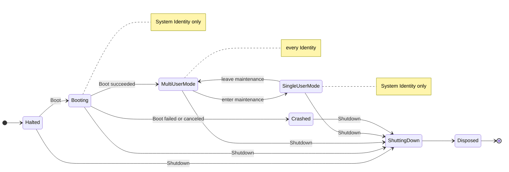

# Backend.Fx Execution

The runtime that hosts an injection container as an Application and runs Invocations through an execution pipeline.

## Application lifecycle

**Application**:
The root object that owns the Composition Root, the Features and the Lifecycle, and runs Invocations.

**Lifecycle**:
The sequence of states an Application moves through, from Halted via Boot to Shutdown. Only the listed transitions are legal; any other attempt fails loudly.
_Avoid_: state machine

**Boot**:
The one-time phase that enables all Features, verifies the Composition Root and lets bootable Features run their startup work. Ends in Multi User Mode or Crashed.
_Avoid_: startup, init

**Halted**:
The state before Boot, the only one in which Features may be added.

**Multi User Mode**:
The state in which every Identity is admitted.

**Single User Mode**:
A maintenance window entered from Multi User Mode in which only the System Identity is admitted; everyone else waits.
_Avoid_: maintenance mode

**Crashed**:
The terminal state after a failed or canceled Boot. No Invocation is admitted.

**Shutdown**:
The phase that rejects all further Invocations and disposes Features in reverse order, then the Composition Root. Ends in Disposed.
_Avoid_: teardown

**Admission**:
The decision whether an Identity may run an Invocation in the Application's current state: admitted, made to wait, or rejected.
_Avoid_: user mode check

## Building blocks

**Feature**:
An optional part of an Application, added before Boot.
_Avoid_: plugin, add-on

**Module**:
A unit of service registrations applied to the Composition Root by a feature.

**Composition Root**:
The encapsulated injection container of an Application.
_Avoid_: container, injector

## Execution

**Invocation**:
One run of a delegate through the execution pipeline, in its own injection scope, on behalf of an Identity.
_Avoid_: request, call

**Operation**:
The decoratable unit of work wrapped around an Invocation's delegate: begun before, completed on success, canceled on failure.

**Identity**:
Who an Invocation runs as.

**System Identity**:
The Identity the Application itself acts as; the only one admitted during Boot and Single User Mode.

**Correlation**:
The identifier that ties an Invocation to related work across process boundaries.
